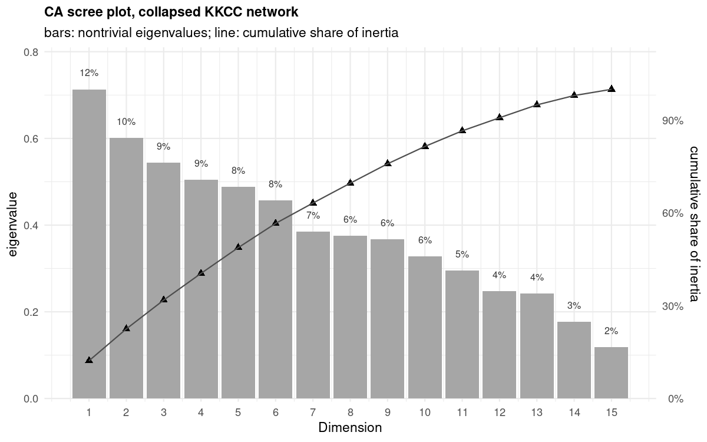
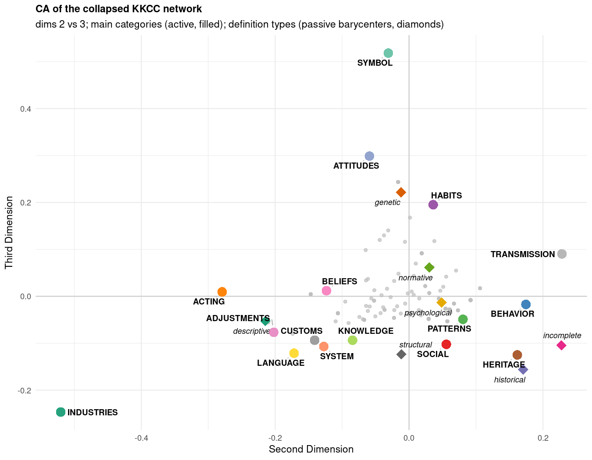
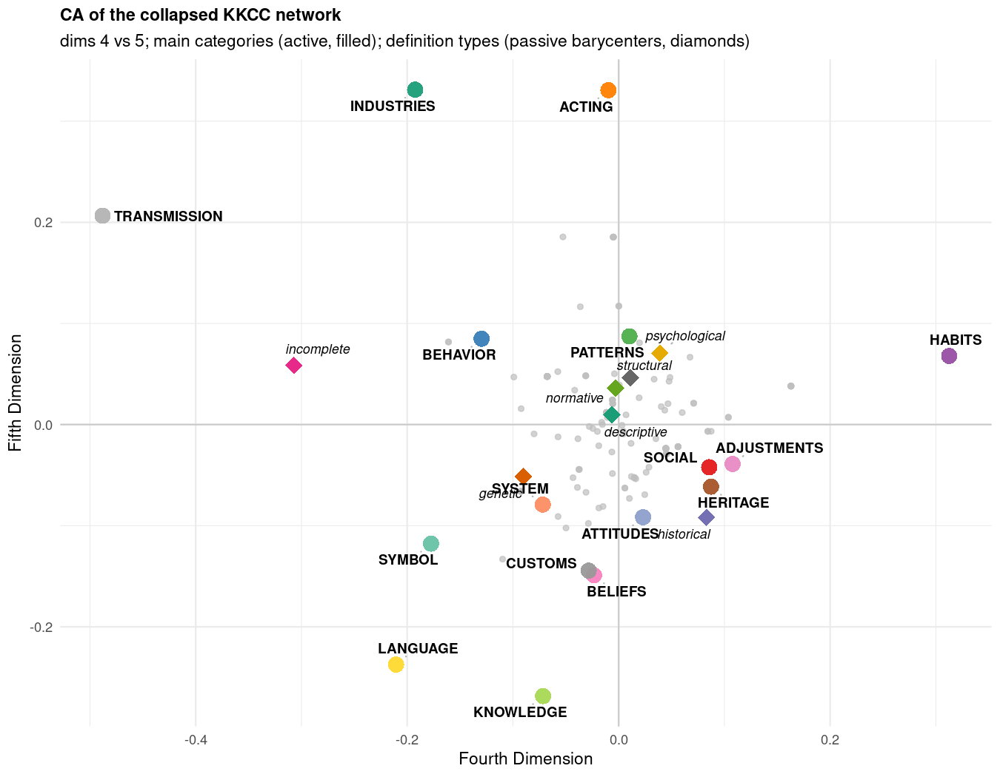
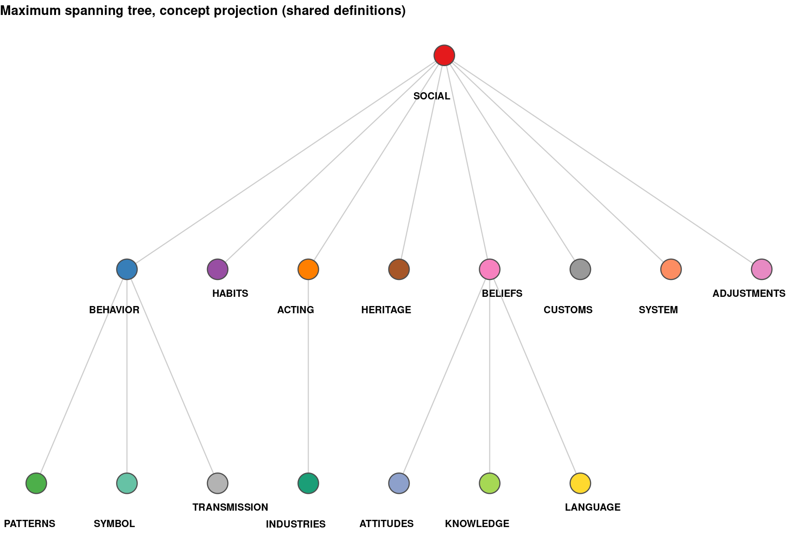
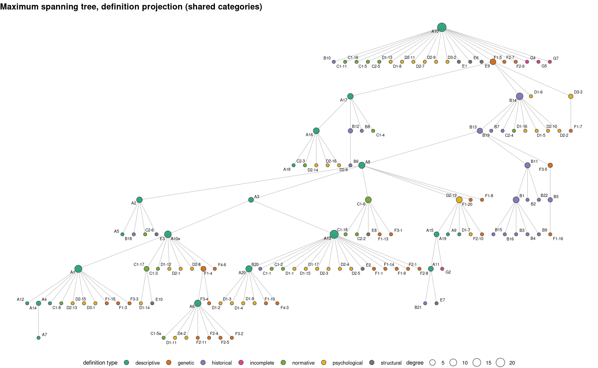
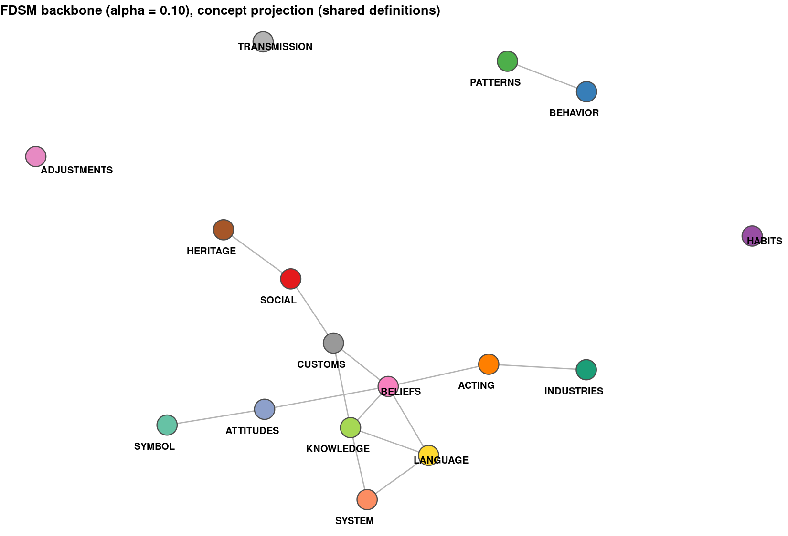
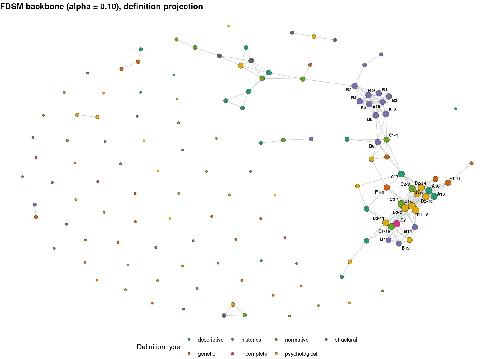

::: {.callout-note}
This report was generated using AI under general human direction. At the time of generation, the contents have not been comprehensively reviewed by a human analyst.

<!--
To indicate human review: Delete the line above about contents not being reviewed, and replace this comment with:
The contents have been reviewed and validated by [Your Name], [Your Role] on [Date].
-->
:::

This report computes basic network statistics for the two-mode network of culture concepts and culture definitions extracted from Table 2 of Boroch's classification of the Kroeber–Kluckhohn Culture Concepts (KKCC). The rows are the 16 main concept categories of the KKCC scheme — auxiliary notions have been collapsed into their parents (union of ties, binarized) — and the columns are 135 definition codes. Statistics follow the conventions of the two-mode basics tutorial.

# Setup

```{r}
#| label: load-packages
library(igraph)
```

```{r}
#| label: load-data
d <- readRDS("data/kkcc_two_mode_main.rds")
A <- d$biadjacency    # main categories (rows) x definitions (columns)
g <- d$graph          # attributed bipartite graph
def_attrs <- readRDS("data/kkcc_two_mode.rds")$def_attrs
```

# Two-mode structure

A common mistake is to report `vcount(g)`, which pools both modes. Counting each mode separately from the bipartite mapping:

```{r}
#| label: mode-counts
n.concepts <- vcount(subgraph(g, V(g)$type == FALSE))
n.defs     <- vcount(subgraph(g, V(g)$type == TRUE))
c(concepts = n.concepts, definitions = n.defs)
```

The edge count matches the number of 1s in the biadjacency matrix:

```{r}
#| label: edge-count
sum(A)
ecount(g)
```

Density is the share of possible concept–definition ties that are present:

```{r}
#| label: density
dens <- sum(A) / (nrow(A) * ncol(A))
round(dens, 4)
```

# Degree distributions

Degrees in the two modes count different things: a concept's degree is the number of definitions using it, and a definition's degree is the number of concepts it expresses.

```{r}
#| label: degree-summary
deg.p <- rowSums(A)
deg.g <- colSums(A)
c(mean.deg.p = round(mean(deg.p), 2), mean.deg.g = round(mean(deg.g), 2),
  min.deg.p = min(deg.p),    min.deg.g = min(deg.g),
  max.deg.p = max(deg.p),    max.deg.g = max(deg.g))
```

Both degree sums equal the edge count, as they must:

```{r}
#| label: degree-sums
c(rowSums = sum(deg.p), colSums = sum(deg.g), edges = sum(A))
```

Degrees vary sharply by definition type and by concept status (main category vs auxiliary notion):

```{r}
#| label: degree-by-type
tapply(deg.g, def_attrs$type[match(names(deg.g), def_attrs$code)],
       function(x) round(mean(x), 2))
```

# Degree centrality

Raw degree centrality is `rowSums(A)` and `colSums(A)`. Normalized by the size of the opposite mode:

```{r}
#| label: norm-centrality
round(deg.p / ncol(A), 3)[1:10]
round(deg.g / nrow(A), 3)[1:10]
```

The most central nodes in each mode:

```{r}
#| label: top-nodes
head(data.frame(concept = names(deg.p), degree = deg.p)[order(-deg.p), ], 10)
head(data.frame(code = names(deg.g), degree = deg.g,
                type = def_attrs$type[match(names(deg.g), def_attrs$code)])[order(-deg.g), ], 10)
```

# Average nearest-neighbor degree

For a concept, the average nearest-neighbor degree is the mean degree of the definitions that use it; for a definition, it is the mean degree of the concepts it expresses.

```{r}
#| label: knn
knn.p <- rowSums(A * rep(colSums(A), each = nrow(A))) / rowSums(A)
knn.g <- as.numeric(t(A) %*% deg.p) / colSums(A)
round(mean(knn.p), 2)
round(mean(knn.g), 2)
```

# Degree correlation

The degree correlation relates each node's degree to the average degree of its opposite-mode neighbors. Positive values indicate assortativity and negative values disassortativity across the two modes.

```{r}
#| label: deg-corr
tm.deg.corr <- function(A) {
  knn.p <- as.numeric(rowSums(A * rep(colSums(A), each = nrow(A))) / rowSums(A))
  knn.g <- as.numeric(t(A) %*% rowSums(A)) / colSums(A)
  list(r = cor(c(rowSums(A), colSums(A)), c(knn.p, knn.g)))
}
round(tm.deg.corr(A)$r, 4)
```

# Bipartite checks and modularity

Structural checks confirm the bipartite structure captured in the graph object:

```{r}
#| label: bipartite-checks
is_bipartite(g)
is_directed(g)
all(bipartite_mapping(g)$type == V(g)$type)
```

Modularity with communities defined by node type attains the low value characteristic of a bipartite graph, since all edges run between the two types and none within:

```{r}
#| label: modularity
V(g)$comm <- as.numeric(V(g)$type) + 1
round(modularity(g, V(g)$comm), 4)
```

# Component structure

An addition beyond the basic tutorial, but important for interpretation: the KKCC two-mode network is not connected.

```{r}
#| label: components
comp <- components(g)
table(comp$csize)
```

The collapsed network is `{r} if (length(comp$csize) == 1) "connected" else "disconnected"`: it has `{r} length(comp$csize)` component(s), with the largest containing `{r} max(comp$csize)` of the `{r} vcount(g)` nodes.

# Correspondence analysis

Correspondence analysis of the collapsed biadjacency matrix follows the two-mode CA tutorial: row and column profile operators are built from the biadjacency matrix, decomposed with `eigen()`, the trivial first dimension (eigenvalue 1) is dropped, and definition scores are sign-aligned to concept scores via the duality relation. Definition types enter as passive supplementary points, located at the mass-weighted barycenter of their member definitions.

```{r}
#| label: run-ca-mst
# runs the full CA + MST pipeline; also writes CA score CSVs and figures
source("analysis-ca-mst-main.R")
```

The first non-trivial dimension accounts for `{r} scales::percent(df.scree$share[1], accuracy = 1)` of the inertia and the first five for `{r} scales::percent(sum(df.scree$share[1:5]), accuracy = 1)`:



In the dim 1–2 map, TRANSMISSION, ADJUSTMENTS, and INDUSTRIES sit far from the remaining categories, which cluster near the origin; the passive type barycenters separate most cleanly on dimensions 2–3 and 4–5.






# Maximum spanning trees

Each mode's one-mode projection is binarized (tie = at least one shared definition in the opposite mode) and reduced to its maximum spanning tree (Kruskal's algorithm on tie multiplicity, implemented in `make.max.st()`), which keeps the strongest `{r} vcount(st.concept) - 1` ties per node set while dropping redundant weaker ones.



In the concept tree, SOCIAL is the root hub, linking to BEHAVIOR, HABITS, ACTING, HERITAGE, BELIEFS, CUSTOMS, SYSTEM, and ADJUSTMENTS; BELIEFS and BEHAVIOR act as secondary hubs for KNOWLEDGE/LANGUAGE/ATTITUDES and for PATTERNS/SYMBOL/TRANSMISSION respectively.



# Projection backbones

Instead of a hard multiplicity threshold, the weighted projections (tie weight = number of shared definitions) are binarized statistically: an edge is retained only if its weight is significantly stronger than expected under the Fixed Degree Sequence Model (FDSM), tested with 10,000 Fastball permutations at `alpha = 0.10` (one-tailed), via the `backbone` package (Neal 2022, *PLOS One*). FDSM was chosen over the default SDSM after model comparison: on this small, sparse network SDSM retains almost nothing (2 concept edges, 0 definition edges at `alpha = 0.05`).

```{r}
#| label: run-backbone
invisible(capture.output(source("analysis-backbone-main.R")))
```

```{r}
#| label: backbone-summary
rbind(concept = sumry(P.p, bb.p), definition = sumry(P.g, bb.g))
```

The backbone keeps `{r} ecount(G.bb.p)` of the `{r} sum(P.p[upper.tri(P.p)] > 0)` concept-projection ties and `{r} ecount(G.bb.g)` of the `{r} sum(P.g[upper.tri(P.g)] > 0)` definition-projection ties. FDSM p-values are Monte Carlo estimates, so exact counts can vary slightly between runs.





# Closeness and betweenness centrality

Degree was covered above; here we add the other two of the big three, following the two-mode normalizations of Borgatti and Everett (1997) [@borgatti_everett97]. Geodesic distances in two-mode networks are always even within a set and odd across sets. For closeness, each node set is normalized by its own theoretical maximum: `N + 2(M−1)` for concepts and `M + 2(N−1)` for definitions (igraph's one-mode `n−1` normalization would give non-sense here). For betweenness, the normalizations depend on which set is larger; since the definitions are the larger set here (135 vs 16), the formulas are swapped relative to the tutorial's Southern Women example. Betweenness is reported as percentages.

```{r}
#| label: run-centrality-prestige
invisible(capture.output(source("analysis-centrality-prestige-main.R")))
```

```{r}
#| label: centrality-top-concepts
cen.con[order(-cen.con$closeness), c("node", "k", "closeness", "betweenness.pct")]
```

```{r}
#| label: centrality-top-definitions
head(cen.def[order(-cen.def$closeness), c("node", "k", "type", "closeness", "betweenness.pct")], 15)
```

SOCIAL and BEHAVIOR dominate both measures, as they dominate degree; the betweenness percentages are far more concentrated than the closeness scores, and a few low-degree definitions (e.g., F1-5, D1-6) achieve comparatively high betweenness by bridging categories that share few definitions.

# Status and prestige

Following the status/prestige tutorial, we score both modes with the two-mode HITS-style power iteration `tm.status(A, t(A))` (Bonacich 1991; biHITS in Liao et al. 2014). The script verifies that the same scores emerge from the dual-projection approach (`status1` on the Breiger projections), from the leading singular vectors of `A`, from the leading eigenvectors of both projections, and from the Faust (1997) duality relation (each node's score is the weighted sum of the other mode's scores, weight `1/sqrt(λ)`). Three PageRank-family refinements follow, each changing who gets how many status points to distribute: two-mode PageRank (co-HITS, degree-normalized), double-normalized PageRank (BGRM, Rui et al. 2007), and square-root normalized BiRank (He et al. 2016). Scores are divided by their maximum for display, so the top node equals 1.000.

```{r}
#| label: prestige-concepts
con.tab
```

```{r}
#| label: prestige-definitions
head(def.tab, 15)
```

Under Bonacich prestige (hits) and PageRank (pr), rankings track degree almost mechanically: SOCIAL and BEHAVIOR lead the concepts, and the highest-degree definitions (A8, C1-6, D2-12) lead that mode. PageRank produces many exact ties at small integer degrees (all `k = 4` definitions score 0.667). The double-normalized BGRM scores invert this logic: ADJUSTMENTS and TRANSMISSION — the concepts with the fewest defining texts, each tied to a distinct set of rarely shared definitions — become the most prestigious, because BGRM rewards nodes that connect to selective (low-degree) partners rather than to many. BiRank's square-root normalization lands between the two extremes. The choice between these models is therefore substantive, not technical: it turns on whether shared use of definitions by many categories should count as prestige (HITS/PageRank) or whether exclusivity should (BGRM).

# Average scores by node attributes

Averaging the centrality and prestige scores over node attributes: definitions carry a type attribute (the sevenfold Boroch classification), while the concepts in the collapsed network have no further attributes beyond degree, so the table below covers definitions only.

```{r}
#| label: means-by-type
type.means
```

Descriptive, historical, and normative definitions have the highest mean degree and also lead on closeness and on the HITS and BiRank prestige averages. Incomplete definitions (G) rank last on every measure, as expected for fragmentary texts. BGRM again runs against the degree gradient, giving genetic and psychological definitions their highest relative averages — these types contain the selective, rarely shared definitions that double normalization rewards. Betweenness averages are small throughout and largest for descriptive definitions.

The finer subgroup cut separates the numbered subgroups within types (C1 rules/ways vs C2 ideas/values; D1 adjustments, D2 learning, D3 habits, D4 psychology; F1 artefacts, F2 ideas, F3 symbols, F4 other). Because some subgroups have very few members (D4 has 1, F4 has 2), their averages should be read as illustrative only.

```{r}
#| label: means-by-subgroup
subgroup.means
```

Within normative, C2 (definitions in terms of ideas and values) outperforms C1 (rules and ways) on every measure except BGRM — C2 definitions have both higher mean degree (2.60 vs 2.17) and higher HITS averages (0.609 vs 0.373). Within genetic, artefact-based (F1) and symbol-based (F3) definitions outrank idea-based (F2) and other (F4) ones. Within psychological, learning (D2) and habits (D3) score above adjustments (D1) on the prestige measures, while BGRM again favors D1 — the selective, rarely shared adjustments definitions.


